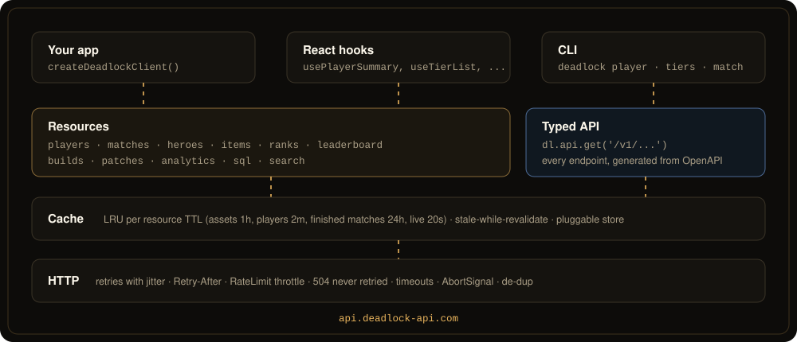

<div align="center">

<a href="https://github.com/justinjd00/deadlock-sdk"></a>

<p>
<a href="https://www.npmjs.com/package/@justinjd00/deadlock-sdk"></a> <a href="https://www.npmjs.com/package/@justinjd00/deadlock-sdk"></a> <a href="https://www.npmjs.com/package/@justinjd00/deadlock-sdk"></a> <a href="https://www.npmjs.com/package/@justinjd00/deadlock-sdk"></a> <a href="https://www.npmjs.com/package/@justinjd00/deadlock-sdk"></a>
<br>
<a href="https://github.com/justinjd00/deadlock-sdk/actions/workflows/ci.yml"></a> <a href="https://github.com/justinjd00/deadlock-sdk/actions/workflows/contract.yml"></a> <a href="https://www.npmjs.com/package/@justinjd00/deadlock-sdk#provenance"></a> <a href="https://www.npmjs.com/package/@justinjd00/deadlock-sdk"></a> <a href="https://www.npmjs.com/package/@justinjd00/deadlock-sdk?activeTab=dependencies"></a> <a href="https://github.com/justinjd00/deadlock-sdk/blob/main/LICENSE"></a>
<br>
<a href="https://github.com/justinjd00/deadlock-sdk/stargazers"></a> <a href="https://github.com/justinjd00/deadlock-sdk/releases"></a> <a href="https://github.com/justinjd00/deadlock-sdk/commits/main"></a> <a href="https://github.com/justinjd00/deadlock-sdk/issues"></a>
</p>

<p>
<a href="#quick-start"><b>Quick start</b></a> &nbsp;·&nbsp;
<a href="#cli"><b>CLI</b></a> &nbsp;·&nbsp;
<a href="#api"><b>API</b></a> &nbsp;·&nbsp;
<a href="#react"><b>React</b></a> &nbsp;·&nbsp;
<a href="#errors-retries-and-rate-limits"><b>Errors</b></a> &nbsp;·&nbsp;
<a href="CHANGELOG.md"><b>Changelog</b></a>
</p>

</div>

TypeScript SDK for [Deadlock](https://store.steampowered.com/app/1422450/Deadlock/) stats, built on the community run [Deadlock API](https://deadlock-api.com). All 132 endpoints are typed from the API's OpenAPI spec, and on top of that you get the parts every stats site ends up writing by hand: player cards, scoreboards with names, tier lists that respect sample size, counters and synergies, Steam id parsing, rank decoding, React hooks and a CLI.

```ts
import { createDeadlockClient } from '@justinjd00/deadlock-sdk';

const dl = createDeadlockClient();

await dl.players.summary('https://steamcommunity.com/profiles/76561197960287930');
// { rank: { label: 'Oracle 4', image }, recent: { winRate, kda, streak }, topHeroes: [...] }

await dl.heroes.tierList({ min_average_badge: 81 }); // S to D, ranked by confidence, Oracle and up
await dl.heroes.counters('haze'); // who Haze beats and who beats Haze
await dl.matches.scoreboard(127843366); // both teams, hero and item names, KDA, souls, damage
await dl.api.get('/v1/players/{account_id}/mate-stats', { path: { account_id: 22202 } }); // anything else, typed
```

## Live from the Deadlock API

Pulled straight from the API this package talks to, refreshed hourly.

<p align="center">
<a href="https://deadlock-api.com"></a> <a href="https://deadlock-api.com"></a> <a href="https://deadlock-api.com"></a> <a href="https://deadlock-api.com"></a>
</p>

## Highlights

<table>
<tr>
<td width="33%" valign="top">

### 🧬 Typed from the spec

`src/generated` is built from the live OpenAPI spec. Paths autocomplete, path and query parameters are checked, responses are inferred. A weekly job fails when the spec drifts.

</td>
<td width="33%" valign="top">

### 🎯 Stats done right

Tier lists and matchups rank by the Wilson lower bound, so a hero with 12 lucky games never tops the list. Pick rates account for 12 heroes per match.

</td>
<td width="33%" valign="top">

### 🛡️ Plays nice with the API

Reads the `RateLimit-*` headers and waits for the window instead of hitting 429. Retries busy servers with `Retry-After`, never retries a 504 query timeout.

</td>
</tr>
<tr>
<td valign="top">

### ⚡ Cached per resource

Assets for an hour, players for two minutes, finished matches for a day, live data for 20 seconds. Stale-while-revalidate and pluggable stores like Redis.

</td>
<td valign="top">

### 🪪 Any Steam id

Account id, SteamID64, `[U:1:x]`, `STEAM_1:0:x` or a profile URL, every method takes them all. Vanity URLs get a clear error instead of a silent 404.

</td>
<td valign="top">

### 🧩 Zero dependencies

Standard `fetch`, Node 20+ and modern browsers, ESM and CommonJS, tree-shakeable, signed with npm provenance. React hooks and the CLI ship in the same package.

</td>
</tr>
</table>

## Quick start

```bash
npm install @justinjd00/deadlock-sdk
```

```ts
import { createDeadlockClient } from '@justinjd00/deadlock-sdk';

const dl = createDeadlockClient({
  apiKey: process.env.DEADLOCK_API_KEY, // optional, raises your rate limits
});

const me = await dl.players.summary('[U:1:22202]');
console.log(
  me.rank?.label,
  me.recent.winRate,
  me.topHeroes.map((h) => h.name)
);
```

Runnable examples live in [`examples/`](examples): a [quick start](examples/quickstart.ts), a [draft helper](examples/draft-helper.ts) that suggests picks into an enemy lineup, and a [React profile card](examples/react-profile-card.tsx).

## CLI

No install needed:

```bash
npx @justinjd00/deadlock-sdk tiers --min-rank oracle
```

Or install it globally and use `deadlock`:

<p align="center"></p>

| Command                      | What it shows                                                  |
| ---------------------------- | -------------------------------------------------------------- |
| `deadlock player <who>`      | Rank, recent form, streak, ranked progress, top heroes         |
| `deadlock matches <who>`     | Recent matches, `--ranked`, `--hero haze`, `--limit 30`        |
| `deadlock rank <who>`        | Current rank                                                   |
| `deadlock search <name>`     | Players by Steam name                                          |
| `deadlock steamid <who>`     | Every Steam id format and the profile URL                      |
| `deadlock match <id>`        | Scoreboard for both teams with items                           |
| `deadlock live`              | Top matches being played right now                             |
| `deadlock tiers`             | Tier list, `--min-rank oracle`, `--days 14`                    |
| `deadlock hero <name>`       | Win rate, best and worst matchups, best teammates              |
| `deadlock items`             | Item win rates and buy timings, `--slot spirit`, `--hero haze` |
| `deadlock leaderboard [reg]` | `eu`, `na`, `sa`, `asia`, `oce`, `--hero` for per hero boards  |
| `deadlock patches`           | Latest patch notes                                             |
| `deadlock sql "<query>"`     | SQL on the public dataset, `sql tables`, `sql schema <table>`  |

`<who>` is any Steam id, a profile URL, or a Steam name (the CLI searches and tells you who it picked). Every command takes `--json`. Meta commands cover the last 30 days unless you pass `--days`. Responses are cached on disk, `--no-cache` skips it and `deadlock cache clear` wipes it. An API key goes in `--api-key` or `DEADLOCK_API_KEY`.

## API

Everything hangs off one client. Methods take an optional last argument with `signal`, `timeout` and `fresh` (skip the cache).

### Players

```ts
await dl.players.summary(player, { matches: 50 }); // profile + rank + recent form + top heroes, in parallel
await dl.players.rank(player); // { tier: 8, subrank: 4, label: 'Oracle 4', image, color }
await dl.players.ranks([a, b, c]); // any number, batched by 1000
await dl.players.matchHistory(player, {
  limit: 20,
  since: new Date('2026-10-01'),
  matchModes: [4],
  heroId: 13,
});
await dl.players.heroStats(player); // per hero totals
await dl.players.enemyStats(player); // who they play against most
await dl.players.mateStats(player); // who they queue with
await dl.players.search('name');
await dl.players.profiles([a, b]);
```

Private players (403) and missing profiles do not break `summary`, those parts are just `undefined`.

### Matches

```ts
const board = await dl.matches.scoreboard(matchId);
board.teams[board.winningTeam]; // [{ heroName, kills, deaths, assists, kda, netWorth, playerDamage, finalItems, ... }]

await dl.matches.get(matchId); // full metadata: item timeline, stat snapshots, objectives, accolades
await dl.matches.getMany(ids, { include_player_info: true }); // bulk, split into requests of 1000
await dl.matches.active({ players: [player] }); // live top matches, optionally with given players
```

### Heroes, items and ranks

```ts
await dl.heroes.list(); // playable heroes, `{ onlyActive: false }` for all
await dl.heroes.get('lady geist'); // by id, name or class name
await dl.heroes.stats({ min_average_badge: 91 }); // win rate, pick rate, KDA, souls, damage, confidence
await dl.heroes.tierList({ min_unix_timestamp: since }, { minMatches: 500 });
await dl.heroes.counters('haze'); // matchups, best first
await dl.heroes.synergies('haze'); // best teammates

await dl.items.shop({ slot: 'spirit', tier: 4 });
await dl.items.get('Spirit Snatch');
await dl.items.stats({ hero_id: 13 }); // win rate and average buy time per item

await dl.ranks.decode(115); // { label: 'Eternus 5', image }
```

Asset calls take a `language` (`'german'`, `'schinese'`, ...) or use the client default.

### Leaderboards, builds, patches

```ts
await dl.leaderboard.get('na', { hero: 'abrams', limit: 100 });
await dl.leaderboard.find('player name', 'eu');
await dl.builds.forHero('haze', { limit: 5 }); // most favorited this week
await dl.patches.latest();
```

### Analytics, SQL and everything else

```ts
// All 23 analytics endpoints, typed by short name.
await dl.analytics.get('item-permutation-stats', { query: { hero_id: 13, comb_size: 2 } });

// Read-only SQL (DuckDB syntax) over the public dataset.
await dl.sql.query<{ hero_id: number; games: number }>(
  'SELECT hero_id, count(*) AS games FROM match_player WHERE start_time > now() - INTERVAL 1 DAY GROUP BY 1 ORDER BY 2 DESC'
);

// Any endpoint, with path autocompletion and checked parameters.
await dl.api.get('/v1/analytics/hero-comb-stats', { query: { comb_size: 3, min_matches: 100 } });
```

### Helpers

All exported on their own, no client needed:

```ts
import {
  toAccountId,
  toSteamId64,
  decodeBadge,
  parseBadge,
  summarizeHistory,
  wilsonLowerBound,
} from '@justinjd00/deadlock-sdk';

toAccountId('https://steamcommunity.com/profiles/76561197960287930'); // 22202
toSteamId64('[U:1:22202]'); // '76561197960287930'
decodeBadge(83).label; // 'Oracle 3'
parseBadge('oracle 3'); // 83, for min_average_badge filters
```

Also: `toSteamId3`, `toSteamId2`, `steamProfileUrl`, `didWin`, `winRate`, `kda`, `normalizeRegion`, `gameModeName`, `matchModeName`, `createSearchIndex`, `toCSV`, `toJSON`.

`dl.search('hayz')` is a typo tolerant local search over heroes and items.

## React

```tsx
import { DeadlockProvider, usePlayerSummary, useTierList } from '@justinjd00/deadlock-sdk/react';

function Card({ player }: { player: string }) {
  const { data, loading, error, refetch } = usePlayerSummary(player);
  if (loading) return <p>Loading…</p>;
  if (error) return <p>{error.message}</p>;
  return (
    <h2>
      {data?.profile?.personaname}: {data?.rank?.label}
    </h2>
  );
}

<DeadlockProvider options={{ apiKey }}>
  <Card player="[U:1:22202]" />
</DeadlockProvider>;
```

Hooks: `usePlayerSummary`, `usePlayerRank`, `useMatchHistory`, `useScoreboard`, `useActiveMatches` (refreshes every 30s), `useHeroes`, `useHeroStats`, `useTierList`, `useLeaderboard`, `usePlayerSearch` (debounced) and the generic `useDeadlockQuery`. Requests are aborted on unmount and stale responses are dropped. The provider is optional; without it hooks share one default client.

## Errors, retries and rate limits

Every failure is a `DeadlockError` with a `code` you can switch on:

```ts
import { isDeadlockError } from '@justinjd00/deadlock-sdk';

try {
  await dl.players.rank(player);
} catch (e) {
  if (isDeadlockError(e) && e.code === 'FORBIDDEN')
    console.log('This player keeps their data private');
}
```

| Code                                  | When                                                            |
| ------------------------------------- | --------------------------------------------------------------- |
| `BAD_REQUEST`, `NOT_FOUND`            | 400, 404                                                        |
| `FORBIDDEN`                           | 403, usually a player who opted out                             |
| `RATE_LIMITED`                        | 429 after retries, `retryAfterMs` tells you how long            |
| `SERVICE_BUSY`                        | 503, retried automatically                                      |
| `QUERY_TIMEOUT`                       | 504, the query is too heavy. Narrow it, retrying would not help |
| `TIMEOUT`, `NETWORK_ERROR`, `ABORTED` | client side                                                     |
| `INVALID_INPUT`                       | bad Steam id, unknown region or hero, missing path parameter    |

GET requests are retried with exponential backoff and jitter (`retry: { retries, minDelay, maxDelay }`, or `false`). When the API reports `RateLimit-Remaining: 0` the client waits for the window to reset before sending the next request (`throttle: false` to opt out). Identical concurrent GETs share one request. Hooks (`onRequest`, `onResponse`, `onRetry`, `onThrottle`) let you log or measure all of it.

Without a key the API allows a fair amount of requests per minute and IP. For more, request a key from the Deadlock API team and pass it as `apiKey`; it is sent as `X-API-KEY`.

## Caching

```ts
createDeadlockClient({
  cache: {
    ttl: { players: 60_000 }, // override per resource, or one number for all
    staleWhileRevalidate: 5 * 60_000, // serve stale data instantly, refresh in the background
    store: redisStore, // anything with get, set, delete, clear
  },
});
```

The cache key is the full URL, so different filters never collide. `cache: false` turns it off.

## How it fits together

<p align="center"></p>

## Credits

All data comes from the [Deadlock API](https://deadlock-api.com), a free community project ([GitHub](https://github.com/deadlock-api)). If you build something with it, credit them; `ATTRIBUTION` has a ready made line. This package is not affiliated with Valve or the Deadlock API team. Deadlock is a trademark of Valve Corporation.

## Contributing

Issues and pull requests are welcome, see [CONTRIBUTING.md](CONTRIBUTING.md). Tests run offline against trimmed and anonymized real responses, and a weekly job checks the SDK against the live API.

## License

[MIT](LICENSE) © Justin Dewitz
